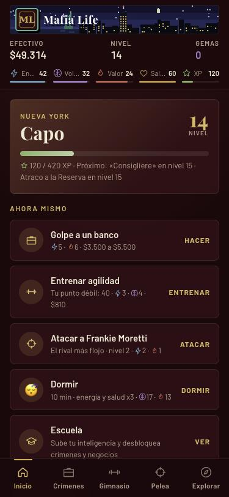
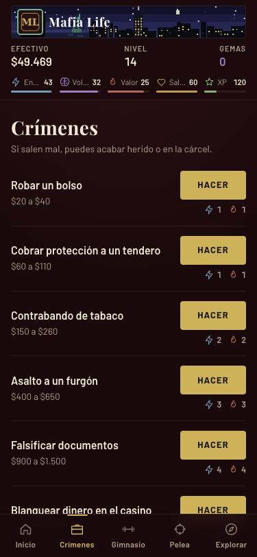
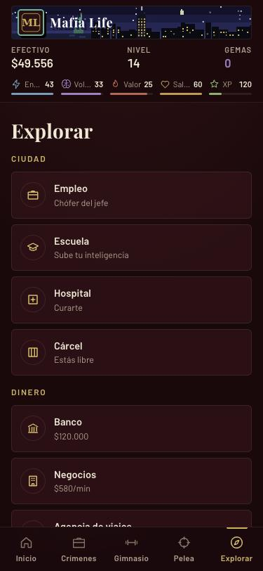
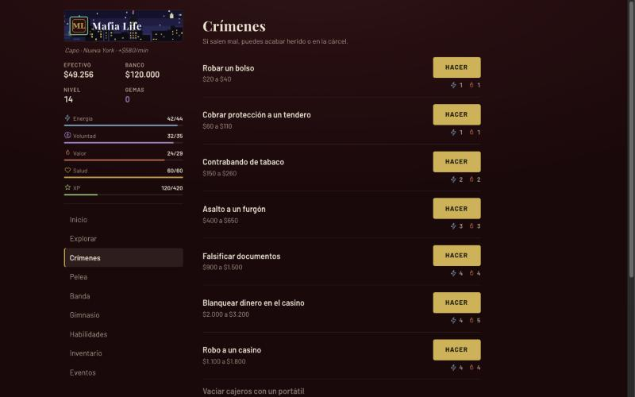

<p align="center">
  
</p>

<h1 align="center">Mafia Life</h1>

<p align="center">
  Juego de mafia por turnos en el navegador. Gratis, sin instalación y sin anuncios.<br>
  <a href="https://daniert.github.io/mafia-life/"><strong>▶ Jugar ahora</strong></a>
</p>

<p align="center">
  
  
  
</p>

## 🎩 De qué va

Empiezas con $500 en Nueva York y sin nombre. Comete crímenes, entrena, estudia, monta negocios y forma tu banda hasta pasar de **Ratero** a **Don**.

Es un homenaje a los juegos de mafia para Android de 2010-2012: energía que se recarga con el tiempo, cárcel, hospital y peleas entre compañeros a la hora del café.

## ✨ Qué puedes hacer

- 💼 **Crímenes** para ganar dinero y experiencia (y arriesgarte a la cárcel)
- 🏋️ **Gimnasio**, 🎓 **escuela** y 💼 **empleo** para mejorar tu personaje
- 🥊 **Peleas** con rivales y ⚔️ **guerras** con tu banda
- 🏢 **Negocios**, 🏦 **banco** y 🎰 **casino** para mover el dinero
- ✈️ **Viajar** de Nueva York a Chicago, Las Vegas, La Habana y Palermo

Lo demás, lo descubres jugando.

<p align="center">
  
</p>

## 📱 Instalar

Abre la [web](https://daniert.github.io/mafia-life/) en el móvil y elige **«Añadir a pantalla de inicio»**. Funciona sin conexión y la partida se guarda en tu navegador.

## 🛠️ Desarrollo

Sin build ni dependencias: todo el juego está en `index.html`. Para probarlo en local:

```bash
python3 -m http.server 8000
```

Cada push a `main` se publica en GitHub Pages.
